# NAGARJUNA TRADERS — PRODUCT REQUIREMENTS DOCUMENT (PRD)

**Document Reference:** `docs/PRD.md`  
**Version:** 3.0.0 (Full-Stack Ordering System, UPI QR, UTR Submission & Admin Management)  
**Status:** Approved Full-Stack Specification  
**Target Platform:** Mobile-First Web (Vite + React 18 + TypeScript + Cloudflare Workers / D1)  
**Environment Mode:** Restricted Test Environment (`PAYMENT_COLLECTION_ENABLED=false`)

---

## 1. Executive Summary & Objective

**Nagarjuna Traders** is a full-stack, mobile-first fireworks catalogue reservation and order management platform based on the historical Diwali dealer catalogue poster from Sivakasi, Tamil Nadu.

The application implements a full customer journey with 10 distinct screens/states, server-authoritative integer paise financial calculations, a tiered advance token deposit policy, a UPI QR test fixture display area, a 12-digit UTR submission workflow with uniqueness enforcement, and a secure administrator dashboard for order fulfilment and manual bank statement reconciliation.

> [!IMPORTANT]
> **PAYMENT COLLECTION RESTRICTION:**
> Real payment collection is strictly disabled by default (`PAYMENT_COLLECTION_ENABLED=false`). The full payment workflow is implemented and testable in a restricted test environment using non-payable QR fixtures (`test-fixture@nagarjunatraders`) and synthetic records. No real money or merchant bank credentials are connected until explicitly authorised for commercial launch.

---

## 2. Core Business Policies & Rules

### 2.1 Tiered Advance Token Deposit Rules

Advance order tokens secure stock reservation and catalogue pricing. The server independently recalculates unit prices and subtotals, enforcing the following tiered token schedule:

- **Order subtotal strictly below ₹200 (20,000 paise):** Advance token is **₹50** (5,000 paise).
- **Order subtotal equal to or above ₹200 (20,000 paise):** Advance token is **₹100** (10,000 paise).
- **Boundary Condition:** Exactly ₹200.00 belongs to the ₹100 tier.
- **Minimum Order Requirement:** Subtotal must be at least ₹50 (5,000 paise) to cover the lowest token tier.
- **Remaining Balance:** `Math.max(0, subtotalPaise - tokenAmountPaise)` payable in cash or UPI at the licensed Sivakasi collection counter.

| Order Subtotal | Token Amount | Remaining Balance Due at Counter |
|---:|---:|---:|
| ₹150.00 (15,000 paise) | ₹50.00 (5,000 paise) | ₹100.00 (10,000 paise) |
| ₹199.00 (19,900 paise) | ₹50.00 (5,000 paise) | ₹149.00 (14,900 paise) |
| ₹200.00 (20,000 paise) | ₹100.00 (10,000 paise) | ₹100.00 (10,000 paise) |
| ₹350.00 (35,000 paise) | ₹100.00 (10,000 paise) | ₹250.00 (25,000 paise) |
| ₹1,000.00 (100,000 paise) | ₹100.00 (10,000 paise) | ₹900.00 (90,000 paise) |

### 2.2 Pricing Integrity & Catalogue Rules
1. **Integer Paise Precision:** Floating-point currency math is prohibited. Every value is tracked in integer paise.
2. **Server-Side Recalculation:** Client-submitted unit prices or line subtotals are never trusted. The server recalculates subtotals from database prices.
3. **No Price Invention:** Items with unresolved price ranges on the poster (e.g., Pandav ₹200–₹250) cannot be submitted in an order until an authorized price is configured by the administrator within printed bounds.
4. **Historical Item Snapshots:** Order line items freeze product names, variant labels, pack sizes, and unit prices at creation time. Subsequent catalogue edits do not alter historical orders.

### 2.3 12-Digit UTR Submission & Reconciliation Rules
1. **String Format:** UTR is strictly validated as a string of exactly 12 numeric digits (`/^\d{12}$/`). It is never parsed as a number to preserve format and prevent leading-zero loss.
2. **Uniqueness Enforcement:** The system enforces uniqueness to prevent duplicate UTR submissions across multiple orders.
3. **Recorded Unverified State:** Upon UTR submission, payment status transitions to `RECORDED_UNVERIFIED`. A submitted UTR is never treated as proof of payment.
4. **Prohibition of Automated Verification:** Automatic payment verification based solely on UTR presence is prohibited.
5. **Manual Bank Statement Reconciliation:** Store staff manually cross-reference customer UTRs against bank statements or SMS notifications and record mandatory reconciliation notes before confirming.

---

## 3. Customer Order Journey (10 Screens / States)

```mermaid
flowchart LR
    S1[1. Home Page] --> S2[2. Customer Form]
    S2 --> S3[3. Catalogue View]
    S3 --> S4[4. Variant Controls]
    S4 --> S5[5. Shopping Cart]
    S5 --> S6[6. Order Review]
    S6 --> S7[7. QR Payment Instructions]
    S7 --> S8[8. UTR Submission Form]
    S8 --> S9[9. Order Confirmation]
    S9 --> S10[10. Order Status Tracker]
```

1. **Home Page:** Authentic store identity (Nagarjuna Traders, Sivakasi), festival banner, catalogue category links, counter pickup policy, and statutory compliance details.
2. **Customer Information Form:** 10-digit Indian mobile number (`^[6-9]\d{9}$`), full name, 18+ age verification attestation, and collection preference.
3. **Product Catalogue:** 6 authentic poster categories (Laddis, Skyshots, Bombs, Jharjhari & Sparklers, Kumpi & Chakri, Others).
4. **Variant Selection & Quantity Controls:** Stepper controls (1–50) with pack info and verified prices.
5. **Shopping Cart:** Real-time item list, item line subtotals, unpriced item alerts, and minimum order check.
6. **Order Review:** Clear financial breakdown: subtotal, tiered advance token, and remaining balance due at counter.
7. **QR Payment Instructions:** Display area showing non-payable UPI test fixture (`test-fixture@nagarjunatraders`), token amount in INR, and order reference.
8. **UTR Submission Form:** Clean input field for 12-digit numeric UTR string with client and server validation.
9. **Order Confirmation:** Unique order reference (`NT-XXXX`), recorded UTR, `RECORDED_UNVERIFIED` status, remaining balance due at counter, and receipt summary.
10. **Order Status Page:** Live operational status stepper (Submitted -> Confirmed -> Preparing -> Ready for Pickup -> Completed), payment reconciliation status, and Sivakasi depot collection instructions.

---

## 4. Admin Management Console

- **Dashboard & KPIs:** Total orders, recorded unverified UTR count, ready-for-pickup count, token collected, and catalogue health.
- **Order Management:** Filter by operational and payment statuses; search by reference, customer name, mobile, or UTR.
- **Manual Bank Statement Reconciliation:** Staff enter mandatory notes (e.g. *"Reconciled with HDFC statement entry #8492"*) to transition payment to `RECONCILED` or `FAILED`.
- **Catalogue & Price Management:** Configure active variant prices within printed bounds, or record overrides with mandatory audit justification.
- **Audit Logs:** Immutable audit trail for price overrides, status progressions, and payment reconciliations.

---

## 5. Statutory Compliance & Non-Functional Requirements

- **Supreme Court of India & PESO Compliance:** In accordance with Explosives Rules 2008, all fireworks orders are counter-pickup only. No courier or public parcel shipping is permitted.
- **Data Privacy & IDOR Prevention:** Customer lookups require cryptographically generated access tokens. Personal records are protected against public enumeration.
- **Cloudflare Edge Deployment:** Static assets served via Cloudflare Pages / Workers Static Assets, edge API routing via Workers, and persistent SQL storage via Cloudflare D1.
