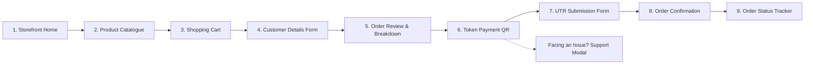

# NAGARJUNA TRADERS: PRODUCT REQUIREMENTS DOCUMENT (PRD)

**Document Reference:** `docs/PRD.md`  
**Version:** 4.0.0 (Festive Indian Diwali Experience & Complete Operations Hub)  
**Status:** Approved Milestone 7 Full-Stack Specification  
**Target Platform:** Mobile-First Web (Vite + React 18 + TypeScript + Cloudflare Workers / D1)  
**Environment Mode:** Restricted Test Environment (`PAYMENT_COLLECTION_ENABLED=false`)

---

## 1. Executive Summary & Objective

**Nagarjuna Traders** is a full-stack, mobile-first fireworks catalogue reservation and order management platform based on the authentic Diwali dealer catalogue poster from Sivakasi, Tamil Nadu.

The website delivers a warm, colorful, image-rich festive Indian Diwali shopping experience featuring:
1. **Curated Product Visuals & Rich Catalogue:** High-quality authentic imagery across 6 categories (Laddis, Skyshots, Bombs, Jharjhari & Sparklers, Kumpi & Chakri, Novelties).
2. **Linear Customer Checkout:** Single-intent progression (`Catalogue → Cart → Customer Form → Review → Token Payment → Submit UTR → Confirmation → Track Order`).
3. **Payment Assistance Flow:** Customer-facing "Facing an issue?" modal generating traceable support references (`ISS-XXXX`).
4. **Complete Store Operations Hub:** Comprehensive 10-tab administrator console featuring inventory adjustments, QR rotation, payment ticket resolutions, customer directory with order history, and sales analytics with RFC 4180 CSV export.

> [!IMPORTANT]
> **PAYMENT COLLECTION RESTRICTION & ZERO HALLUCINATED REVENUE:**
> Real payment collection is strictly disabled (`PAYMENT_COLLECTION_ENABLED=false`). The full payment workflow is simulated using non-payable QR fixtures (`test-fixture@nagarjunatraders`) and synthetic records.
> **Zero Hallucinated Revenue Invariant:** Unverified customer UTR submissions are strictly recorded as `RECORDED_UNVERIFIED` and are NEVER tallied into verified bank receipts. Verified funds remain ₹0.00 until authenticated against bank statement entries.

---

## 2. Core Business Policies & Rules

### 2.1 Tiered Advance Token Deposit Rules
Advance tokens secure stock reservations at authentic poster prices. The server independently recalculates prices and subtotals, enforcing:
- **Order subtotal strictly below ₹200 (20,000 paise):** Advance token is **₹50** (5,000 paise).
- **Order subtotal equal to or above ₹200 (20,000 paise):** Advance token is **₹100** (10,000 paise).
- **Boundary Condition:** Exactly ₹200.00 belongs to the ₹100 tier.
- **Minimum Order Requirement:** Subtotal must be at least ₹50 (5,000 paise) to cover the advance token.
- **Remaining Balance:** `Math.max(0, subtotalPaise - tokenAmountPaise)` payable in cash or UPI at the licensed counter handover.

| Order Subtotal | Token Amount | Remaining Balance Due at Counter |
|---:|---:|---:|
| ₹150.00 (15,000 paise) | ₹50.00 (5,000 paise) | ₹100.00 (10,000 paise) |
| ₹199.00 (19,900 paise) | ₹50.00 (5,000 paise) | ₹149.00 (14,900 paise) |
| ₹200.00 (20,000 paise) | ₹100.00 (10,000 paise) | ₹100.00 (10,000 paise) |
| ₹350.00 (35,000 paise) | ₹100.00 (10,000 paise) | ₹250.00 (25,000 paise) |
| ₹1,000.00 (100,000 paise) | ₹100.00 (10,000 paise) | ₹900.00 (90,000 paise) |

### 2.2 Pricing & Catalogue Integrity
1. **Integer Paise Precision:** All money calculations operate strictly in integer paise.
2. **Server-Side Recalculation:** Subtotals are recomputed from database prices upon order creation.
3. **No Price Invention:** Unresolved range items on the poster (e.g. Pandav ₹200–₹250) cannot be submitted until priced within printed bounds.
4. **Historical Item Snapshots:** Order items freeze variant names, pack sizes, and unit prices at submission time.

### 2.3 Inventory & Stock Reservation
1. **Reservation on Submission:** Placing an order reserves stock (`reserved_stock += qty`).
2. **Cancellation Release:** Cancelling or rejecting an order releases reserved stock (`reserved_stock -= qty`).
3. **Fulfilment Commit:** Order completion permanently decrements physical stock (`current_stock -= qty`, `reserved_stock -= qty`).
4. **Manual Adjustments:** Admin can adjust physical inventory with mandatory audit reason logging.

---

## 3. Customer Shopping Journey (Linear Flow)

1. **Storefront Home:** Warm festive aesthetic, gold diya motif, 6 visual category cards, store counter pickup policy, and ordering assistance steps.
2. **Product Catalogue:** Category filter pills, instant search, product imagery, discrete poster estimates, and pack info.
3. **Shopping Cart:** Real-time item lines, quantity steppers, subtotal validation, and minimum order check.
4. **Customer Details Form:** 10-digit Indian mobile number (`^[6-9]\d{9}$`), full name, 18+ statutory age attestation, and pickup preference.
5. **Order Review:** Itemized breakdown, tiered token calculation, and remaining balance due at counter.
6. **Token Payment QR:** High-contrast QR fixture display, token amount in INR, order reference, and "Facing an issue?" assistance modal.
7. **UTR Submission Form:** Clean 12-digit numeric input with client and server validation.
8. **Order Confirmation:** Unique order reference (`NT-XXXX`), token receipt, and `RECORDED_UNVERIFIED` status.
9. **Order Status Tracker:** Live 5-step operational tracker (`SUBMITTED` → `CONFIRMED` → `PREPARING` → `READY_FOR_PICKUP` → `COMPLETED`) protected by order tokens.
10. **Payment Issue Flow:** Generates traceable issue reference (`ISS-XXXX`) queued directly in the admin support inbox.

---

## 4. Administrator Operations Hub

The administrative console is protected by Cloudflare Access JWT validation in production and isolated tokens in test mode:

1. **Overview & KPIs:** Real-time metrics for total orders, unverified UTR submissions, verified funds (₹0.00), low stock alerts, and open support issues.
2. **Order Management:** Status progression controls, search by reference/mobile, customer notes, and itemized snapshots.
3. **Inventory & Stock:** Real-time stock levels, active reservations, available inventory, automated low-stock warnings, manual stock adjustments, and immutable movement audit logs.
4. **QR Versions & Rotation:** Active fixture display, draft version uploads (PNG/JPEG raster only; SVG rejected), and atomic activation with change notes.
5. **Payment Support Issues:** Support ticket queue, issue categorization, status toggles (`OPEN`, `IN_PROGRESS`, `RESOLVED`, `DISMISSED`), and staff contact notes.
6. **Customer Directory:** Directory tracking lifetime spend, total orders, first/last purchase dates, and complete order history drawer.
7. **Sales Reports & Analytics:** Date-range filters (Today, 7D, 30D, All), Gross Booked Value vs Verified Bank Funds (Zero Hallucinated Revenue), daily trends, top products breakdown, and RFC 4180 CSV export.
8. **Catalogue & Pricing:** Poster inventory with bounds enforcement and audited price override justifications.
9. **Audit Trail:** Immutable stream for price updates, inventory movements, and system actions.
10. **System Settings:** Operational parameters, environment gating verification, and D1 binding status.

---

## 5. Compliance & Security Invariants

- **Explosives Rules 2008 & Statutory Compliance:** Fireworks orders are strictly counter-pickup at licensed premises. No courier or public transport delivery.
- **IDOR Protection:** Customer lookups require cryptographically generated access tokens. Public reference enumeration is rejected.
- **Fail-Closed Access Gate:** Administrative endpoints strictly enforce Cloudflare Access RS256 assertions in production.
- **Cloudflare Edge Deployment:** React 18 frontend hosted on Cloudflare Pages, edge APIs via Workers, and SQL persistence via Cloudflare D1.
