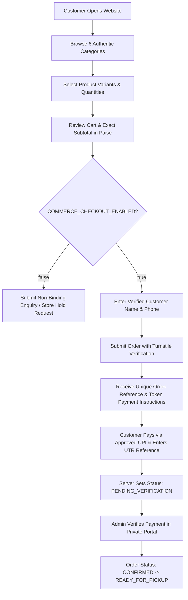

# NAGARJUNA TRADERS — PRODUCT REQUIREMENTS DOCUMENT (PRD)

**Document Reference:** `docs/PRD.md`  
**Version:** 2.0.0 (Correction Milestone — Portfolio Demo Mode)  
**Status:** Approved Portfolio Specification  
**Target Platform:** Mobile-First Web (Vite + React + TypeScript)  
**System Mode:** Portfolio Demo Mode (`PORTFOLIO_DEMO_MODE=true` / Simulated Checkout & Fixed ₹100 Token)

---

## 1. Executive Summary & Project Nature

**Nagarjuna Traders** is a showcase engineering portfolio project demonstrating the architecture, mobile-first design, financial precision, and simulated ordering mechanics of an authentic Diwali fireworks web application based on a supplied Sivakasi dealer poster.

> [!IMPORTANT]
> **PORTFOLIO DEMONSTRATION ONLY:**
> This website is strictly an educational engineering portfolio demonstration. No real fireworks sales, commercial orders, physical delivery, courier transport, or live financial transactions are processed. All checkouts and payments are simulated.

### Key Tenets
1. **Zero Live Commercial Transactions:** No live payment gateways, real UPI credential collection, or merchant banking integrations are connected.
2. **Fixed ₹100 Demo Token:** Every valid demo order requires a fixed simulated booking token of ₹100 (`TOKEN_AMOUNT_PAISE = 10000`). Token amount is never a percentage or variable formula.
3. **Minimum Order Requirement (₹100):** Orders must have a subtotal of at least ₹100 to proceed to simulated checkout. If subtotal is below ₹100, checkout is blocked with: *"Add items until your subtotal reaches ₹100. The demo token amount is fixed at ₹100."*
4. **Authenticity Over Invention:** The supplied physical catalogue poster is the single source of truth. Unconfirmed variant prices or pack specifications are kept as unpriced enquiry items; range items require confirmation before proceeding to simulated payment.
5. **Transient Customer Information:** Customer details (name, phone, notes) are kept strictly in transient React component state and are never persisted to `localStorage` or remote databases.
6. **Financial Precision:** All prices, line items, subtotals, tokens, and remaining balances are tracked strictly in integer paise. Remaining balance is `Math.max(0, subtotalPaise - 10000)` and is never negative.

---

## 2. Target Users & Personas

### Persona A: Festive Retail Customer ("Ravi", Mobile Shopper)
- **Device:** Android smartphone (low-to-mid tier, 4G / mobile data).
- **Need:** Quickly view Diwali cracker prices, pick items for family celebrations, know exact pack quantities, see the upfront token booking amount, and submit a store pickup booking without navigating complex checkout steps or installing an app.
- **Pain Points:** Confusing cracker pricing, hidden delivery scams, broken mobile websites, slow connections, fear of duplicate UPI payments.

### Persona B: Store Operator / Administrator ("Nagarjuna", Business Owner)
- **Device:** Smartphone and desktop tablet/laptop at the billing counter.
- **Need:** Review incoming bookings, manually verify customer UPI reference numbers (UTR) against bank SMS/app notifications, update variant prices when wholesaler rates fluctuate, and flag orders as "Ready for Pickup".
- **Pain Points:** WhatsApp chaos, manual pen-and-paper booking mistakes, reconciling ambiguous payments, inventory stockouts during peak Diwali rush.

---

## 3. Scope & Exclusions

### In-Scope (Phase 1–6)
- Mobile-first responsive web client (customer-facing).
- Authentic 6-category catalogue browsing with variant selector.
- Client-side cart with real-time token payment (e.g., 20% or flat rate) and balance computation.
- Server-authoritative order creation and price verification.
- Feature-flagged commerce engine (`COMMERCE_CHECKOUT_ENABLED=false` falling back to legal enquiry / reservation mode).
- Dedicated admin portal with secure authentication for product, variant, order, and payment management.
- Audit trail for admin order and payment status transitions.
- Cloudflare Turnstile bot protection and strict rate-limiting.

### Explicit Exclusions (Out-of-Scope)
- **No Direct Courier / Inter-State Shipping:** Strictly forbidden by Indian Explosives Rules and Supreme Court directives. Fulfilment is restricted to licensed counter pickup / permitted local handover.
- **No Floating-Point Math:** All currency must be represented as integer paise.
- **No User Account Registration:** Customers do not create passwords. Lookup uses random cryptographic order tokens and mobile numbers.
- **No Live Checkout Activation Prior to Legal Approval:** Live payment capture remains disabled until compliance gates are cleared.

---

## 4. User Journeys & Functional Requirements

### 4.1 Customer Web Application Requirements (C-REQ)

- **C-REQ-01 (Catalogue Navigation):** Customer can browse all 6 categories: Laddis, Skyshots, Bombs, Jharjhari & Sparklers, Kumpi & Chakri, and Others.
- **C-REQ-02 (Variant Selection):** Items with multiple sizes or prices (e.g., Tiger Bomb, Big Lanka Laddi) require explicit variant selection before adding to cart. No order can be placed with unpriced or ambiguous items.
- **C-REQ-03 (Price Transparency):** Exact item unit prices and line subtotals display clearly in ₹ (INR). Total shows:
  - Gross Order Subtotal
  - Token Payment Due Now (default 20% or admin-configured policy)
  - Remaining Balance Due at Pickup
- **C-REQ-04 (Customer Input):** Customer provides Full Name and 10-digit Indian Mobile Number (`^[6-9]\d{9}$`). Address is optional and only displayed if local delivery is legally permitted.
- **C-REQ-05 (Order Submission):** Customer submits order protected by Cloudflare Turnstile. Server generates a cryptographically non-enumerable order reference (e.g., `NT-2026-XXXXXX`) and a secret tracking token.
- **C-REQ-06 (Payment Instructions):** Displays the configured store UPI VPA / QR code with exact token amount and pre-filled transaction note (`NT-XXXXXX`).
- **C-REQ-07 (Payment Reference Entry):** Customer can submit their 12-digit UPI UTR / Transaction Reference number. Client notifies customer that order remains in `PENDING_VERIFICATION` until verified by store staff.
- **C-REQ-08 (Order Status Tracking):** Customer can bookmark or revisit `/order/{orderId}?token={secretToken}` to inspect real-time status without account login.

### 4.2 Admin Portal Requirements (A-REQ)

- **A-REQ-01 (Restricted Access):** Admin console `/admin` strictly protected via Cloudflare Access (Zero Trust OTP / Google Workspace) or signed JWT cookies. No public self-registration.
- **A-REQ-02 (Product & Variant Management):** Admin can create, edit, activate, deactivate, and set exact selling prices (in paise) for all variants. Prevents publishing items without confirmed prices.
- **A-REQ-03 (Inventory Control):** Optional inventory tracking per variant. Items with 0 stock automatically reflect as `OUT_OF_STOCK` in customer client.
- **A-REQ-04 (Order Management):** Table of orders filterable by date, operational status, and payment status. Detailed modal shows customer contact, items, price snapshots, and notes.
- **A-REQ-05 (Payment Verification):** Authorised operator can match customer-submitted UTR against bank records, marking payment as `VERIFIED_TOKEN` or `VERIFIED_FULL`. All state changes log operator ID and timestamp.
- **A-REQ-06 (Operational Workflow):** State progression: `SUBMITTED` -> `CONFIRMED` -> `PREPARING` -> `READY_FOR_PICKUP` -> `COMPLETED` (or `CANCELLED`).
- **A-REQ-07 (Audit History):** Immutable event log tracking every status update, price change, and payment verification.

---

## 5. Non-Functional Requirements (NFR)

- **NFR-01 (Performance & Budget):** Lighthouse mobile performance score ≥ 90. First Contentful Paint (FCP) < 1.2s, Largest Contentful Paint (LCP) < 2.0s on 4G network. Total initial bundle size < 120 KB gzipped.
- **NFR-02 (Zero Hosting Cost):** Operates 100% within Cloudflare free limits:
  - Workers: < 100,000 requests/day
  - D1 Database: < 5M read rows/day, < 100k write rows/day, < 5GB storage
  - Turnstile: Free tier
- **NFR-03 (Data Minimisation & Privacy):** Strictly collects only customer name and mobile number. Compliant with Digital Personal Data Protection Act (DPDP) 2023.
- **NFR-04 (Security):** Zero plain-text secrets in repository. Parameterised SQL queries for all D1 interactions. Rate limiting on all mutating endpoints.
- **NFR-05 (Accessibility):** WCAG 2.2 Level AA compliance. Minimum touch target 44×44px, color contrast ratio ≥ 4.5:1.

---

## 6. Business Rules & Financial Model
 
| Rule ID | Rule Name | Description |
|---|---|---|
| **BR-01** | **Paise Accounting** | All prices, line totals, subtotals, and tokens are stored and computed in integer paise. Formatted as `₹(paise / 100).toFixed(2)` for display only. |
| **BR-02** | **Price Snapshotting** | When a demo order is created, prices are snapshotted in `demo_orders`. |
| **BR-03** | **Fixed Token (₹100)** | Fixed demo token amount is exactly ₹100 (`TOKEN_AMOUNT_PAISE = 10000`). It is NOT a percentage and does not vary with subtotal. |
| **BR-04** | **Minimum Subtotal (₹100)** | A demo order must have a subtotal of at least ₹100 before simulated checkout. If `< ₹100`, shows: *"Add items until your subtotal reaches ₹100. The demo token amount is fixed at ₹100."* |
| **BR-05** | **Balance Calculation** | Remaining Balance = `Math.max(0, subtotalPaise - 10000)`. Never negative. |
| **BR-06** | **Unpriced Range Items Gating** | Items without confirmed numeric prices (e.g. range items like Pandav) can be added to the demo basket, but simulated payment is blocked until every item has a usable confirmed price. |
| **BR-07** | **Portfolio Demo Simulation** | All checkouts, authorizations, and orders are simulated. Statuses include `PENDING`, `SUCCESS`, and `FAILED` with retry capability. No real banking APIs are called. |

---

## 7. Acceptance Criteria Summary

1. Customers can browse all 6 authentic poster categories on mobile devices without layout overflow.
2. Sparkler prices reflect exact poster rates (₹180 to ₹350); Kumpi is restricted to Medium and Large only.
3. Cart calculates correct subtotal, fixed ₹100 token (`10000` paise), and non-negative remaining balance in integer paise.
4. If subtotal is below ₹100, simulated checkout is disabled with the prescribed minimum subtotal notice.
5. If unpriced range items are present in the basket, simulated payment is gated with the price confirmation notice.
6. Customer details remain transient and are never saved to `localStorage`.
7. Simulated payment flow demonstrates pending authorization spinner, test success, test failure, and demo order confirmation record (`DEMO-NT-XXXX`).
8. Notice clearly displayed on header, footer, cart, and checkout: *"Portfolio Demo Only. No real orders, fireworks sales, delivery, or payments are processed."*
