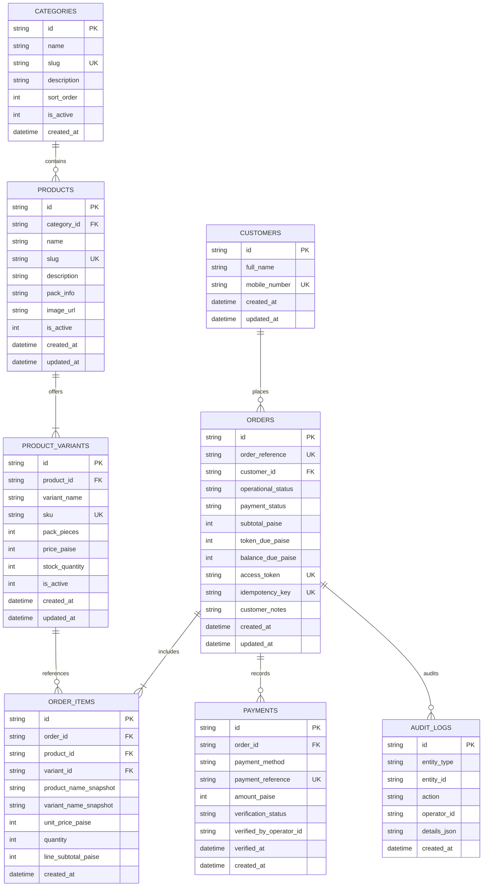

# NAGARJUNA TRADERS — DATA MODEL SPECIFICATION

**Document Reference:** `docs/data-model.md`  
**Database Engine:** Cloudflare D1 (Serverless Distributed SQLite)  
**Currency Units:** Integer Paise (₹1 = 100 paise; no floating-point arithmetic)  
**Integrity Level:** Foreign Keys Enabled (`PRAGMA foreign_keys = ON;`)

---

## 1. Relational Entity Relationship Diagram



---

## 2. Table Definitions & DDL Scripts

### 2.1 `categories`
```sql
CREATE TABLE IF NOT EXISTS categories (
    id TEXT PRIMARY KEY,
    name TEXT NOT NULL,
    slug TEXT NOT NULL UNIQUE,
    description TEXT,
    sort_order INTEGER NOT NULL DEFAULT 0,
    is_active INTEGER NOT NULL DEFAULT 1,
    created_at TEXT NOT NULL DEFAULT (datetime('now'))
);
```

### 2.2 `products`
```sql
CREATE TABLE IF NOT EXISTS products (
    id TEXT PRIMARY KEY,
    category_id TEXT NOT NULL REFERENCES categories(id) ON DELETE RESTRICT,
    name TEXT NOT NULL,
    slug TEXT NOT NULL UNIQUE,
    description TEXT,
    pack_info TEXT,
    image_url TEXT,
    is_active INTEGER NOT NULL DEFAULT 1,
    created_at TEXT NOT NULL DEFAULT (datetime('now')),
    updated_at TEXT NOT NULL DEFAULT (datetime('now'))
);
```

### 2.3 `product_variants`
```sql
CREATE TABLE IF NOT EXISTS product_variants (
    id TEXT PRIMARY KEY,
    product_id TEXT NOT NULL REFERENCES products(id) ON DELETE CASCADE,
    variant_name TEXT NOT NULL,
    sku TEXT NOT NULL UNIQUE,
    pack_info TEXT,
    is_pack_verified INTEGER NOT NULL DEFAULT 0,
    printed_price_text TEXT NOT NULL,
    printed_min_paise INTEGER,                -- Nullable minimum printed boundary in paise
    printed_max_paise INTEGER,                -- Nullable maximum printed boundary in paise
    printed_options_json TEXT,                -- Nullable JSON array of discrete printed options [paise, ...]
    source_notes TEXT,                        -- Verbatim poster notes & confirmation requirements
    demo_price_paise INTEGER,                 -- Nullable active demo price in paise (null if unresolved)
    price_status TEXT NOT NULL DEFAULT 'PRINTED_ESTIMATE'
        CHECK (price_status IN ('PRINTED_ESTIMATE', 'PRICE_ON_ENQUIRY', 'CONFIRMED')),
    pricing_origin TEXT NOT NULL
        CHECK (pricing_origin IN ('POSTER_EXACT', 'POSTER_RANGE', 'UNCONFIRMED_MAPPING', 'DEMO_NUMERIC', 'OWNER_CONFIRMED')),
    stock_quantity INTEGER NOT NULL DEFAULT 100 CHECK (stock_quantity >= 0),
    is_available INTEGER NOT NULL DEFAULT 1,
    created_at TEXT NOT NULL DEFAULT (datetime('now')),
    updated_at TEXT NOT NULL DEFAULT (datetime('now'))
);
CREATE INDEX IF NOT EXISTS idx_variants_product ON product_variants(product_id);
CREATE INDEX IF NOT EXISTS idx_variants_sku ON product_variants(sku);
```

### 2.4 `demo_orders`
```sql
CREATE TABLE IF NOT EXISTS demo_orders (
    id TEXT PRIMARY KEY,
    order_reference TEXT NOT NULL UNIQUE,      -- Format: DEMO-NT-XXXX
    customer_name TEXT NOT NULL,
    customer_mobile TEXT NOT NULL CHECK (length(customer_mobile) = 10),
    fulfilment_preference TEXT NOT NULL DEFAULT 'COUNTER_PICKUP'
        CHECK (fulfilment_preference IN ('COUNTER_PICKUP', 'DELIVERY_ENQUIRY')),
    operational_status TEXT NOT NULL DEFAULT 'SUBMITTED' 
        CHECK (operational_status IN ('SUBMITTED', 'CONFIRMED', 'PREPARING', 'READY_FOR_PICKUP', 'COMPLETED', 'CANCELLED')),
    payment_status TEXT NOT NULL DEFAULT 'UNPAID'
        CHECK (payment_status IN ('UNPAID', 'PENDING_VERIFICATION', 'VERIFIED_TOKEN', 'FAILED')),
    subtotal_paise INTEGER NOT NULL CHECK (subtotal_paise >= 10000),       -- Min ₹100.00 subtotal
    token_amount_paise INTEGER NOT NULL DEFAULT 10000,                     -- Strictly fixed ₹100.00
    remaining_balance_paise INTEGER NOT NULL CHECK (remaining_balance_paise >= 0),
    access_token TEXT NOT NULL UNIQUE,        -- Secret cryptographic UUID
    idempotency_key TEXT UNIQUE,
    customer_notes TEXT,
    payment_reference TEXT,                   -- 12-digit simulated UTR
    is_simulated_demo INTEGER NOT NULL DEFAULT 1 CHECK (is_simulated_demo = 1),
    created_at TEXT NOT NULL DEFAULT (datetime('now')),
    updated_at TEXT NOT NULL DEFAULT (datetime('now'))
);
CREATE INDEX IF NOT EXISTS idx_demo_orders_ref ON demo_orders(order_reference);
CREATE INDEX IF NOT EXISTS idx_demo_orders_op_status ON demo_orders(operational_status);
CREATE INDEX IF NOT EXISTS idx_demo_orders_pay_status ON demo_orders(payment_status);
CREATE INDEX IF NOT EXISTS idx_demo_orders_created_at ON demo_orders(created_at DESC);
```

### 2.5 `demo_order_items` (Frozen Historical Snapshots)
```sql
CREATE TABLE IF NOT EXISTS demo_order_items (
    id TEXT PRIMARY KEY,
    order_id TEXT NOT NULL REFERENCES demo_orders(id) ON DELETE CASCADE,
    product_id TEXT NOT NULL,
    variant_id TEXT NOT NULL,
    product_name_snapshot TEXT NOT NULL,
    variant_name_snapshot TEXT NOT NULL,
    unit_price_paise INTEGER NOT NULL CHECK (unit_price_paise > 0),
    quantity INTEGER NOT NULL CHECK (quantity > 0 AND quantity <= 50),
    line_subtotal_paise INTEGER NOT NULL CHECK (line_subtotal_paise > 0),
    created_at TEXT NOT NULL DEFAULT (datetime('now'))
);
CREATE INDEX IF NOT EXISTS idx_demo_order_items_order ON demo_order_items(order_id);
```

### 2.6 `price_audit_logs`
```sql
CREATE TABLE IF NOT EXISTS price_audit_logs (
    id TEXT PRIMARY KEY,
    entity_type TEXT NOT NULL CHECK (entity_type IN ('VARIANT_PRICE', 'ORDER_STATUS', 'PAYMENT_VERIFICATION', 'SYSTEM_SETTING')),
    entity_id TEXT NOT NULL,
    action TEXT NOT NULL,
    operator_id TEXT NOT NULL,
    old_value_json TEXT,
    new_value_json TEXT,
    reason TEXT,
    is_override INTEGER NOT NULL DEFAULT 0,
    created_at TEXT NOT NULL DEFAULT (datetime('now'))
);
CREATE INDEX IF NOT EXISTS idx_audit_logs_entity ON price_audit_logs(entity_type, entity_id);
CREATE INDEX IF NOT EXISTS idx_audit_logs_created_at ON price_audit_logs(created_at DESC);
```

### 2.7 `system_settings`
```sql
CREATE TABLE IF NOT EXISTS system_settings (
    key TEXT PRIMARY KEY,
    value TEXT NOT NULL,
    description TEXT,
    updated_at TEXT NOT NULL DEFAULT (datetime('now'))
);
```

---

## 3. Financial Calculation Invariants (Fixed ₹100 Demo Token)

1. **Paise Integrity:** Every calculation follows:
   $$\text{line\_subtotal\_paise} = \text{unit\_price\_paise} \times \text{quantity}$$
   $$\text{subtotal\_paise} = \sum_{i} \text{line\_subtotal\_paise}_i$$
   $$\text{token\_amount\_paise} = 10000 \quad (\text{Strictly fixed at ₹100.00; NOT a percentage})$$
   $$\text{balance\_due\_paise} = \max\left(0, \text{subtotal\_paise} - \text{token\_amount\_paise}\right)$$
2. **Subtotal Minimum Gating:** A demo order requires $\text{subtotal\_paise} \ge 10000$ (₹100.00). If below ₹100, simulated checkout is blocked.
3. **No Fabricated Pricing:** Range items and unconfirmed mappings have `pricePaise: null`. They can be added to the enquiry basket but block final payment simulation until confirmed.
4. **Zero Inconsistent State:** The sum of priced `lineSubtotalPaise` must exactly equal `subtotalPaise`.

---

## 4. TypeScript Client & Portfolio Demo Models

### 4.1 Constants
```typescript
export const TOKEN_AMOUNT_PAISE = 10000;       // Fixed ₹100.00 demo token
export const MIN_ORDER_SUBTOTAL_PAISE = 10000; // Minimum ₹100.00 order subtotal
```

### 4.2 Pricing Origins & Price Status
```typescript
export type PricingOrigin =
  | 'POSTER_EXACT'          // Exact price printed on supplied poster
  | 'POSTER_RANGE'          // Price range printed on poster (e.g. ₹200 to ₹250)
  | 'UNCONFIRMED_MAPPING'   // Multiple sizes without per-size pricing (e.g. Tiger Bomb 3-6)
  | 'DEMO_NUMERIC'          // Designated demo price
  | 'OWNER_CONFIRMED';      // Explicitly confirmed by store owner

export type PriceStatus =
  | 'PRINTED_ESTIMATE'      // Exact printed estimate
  | 'PRICE_ON_ENQUIRY'      // Unpriced range item
  | 'CONFIRMED';            // Owner-confirmed
```

### 4.3 Cart Totals & Simulated Demo Records
```typescript
export interface CartTotals {
  totalQuantity: number;
  pricedItemCount: number;
  unpricedItemCount: number;
  subtotalPaise: number;
  provisionalSubtotalPaise: number;
  tokenAmountPaise: number;         // Fixed 10,000 paise (₹100)
  remainingBalancePaise: number;    // max(0, subtotal - 10,000)
  canProceedToCheckout: boolean;    // subtotal >= 10,000 && !hasUnpricedItems
  minOrderRequirementMet: boolean;  // subtotal >= 10,000
  hasUnpricedItems: boolean;        // unpricedItemCount > 0
  checkoutBlockedReason?: string;
}

export type SimulatedPaymentStatus =
  | 'NOT_STARTED'
  | 'PENDING'
  | 'SUCCESS'
  | 'FAILED';

export interface DemoOrderRecord {
  demoOrderId: string;             // Format: DEMO-NT-XXXX
  createdAt: string;
  customerName: string;
  customerMobile: string;
  items: CartItem[];
  subtotalPaise: number;
  tokenAmountPaise: number;        // Fixed 10,000 paise
  remainingBalancePaise: number;
  paymentStatus: SimulatedPaymentStatus;
  isSimulatedDemo: true;
}
```

### 4.4 Data Minimisation & Transient State Invariant
- Customer personal data (`CustomerDetails`: name, phone number, collection preference, age attestation, notes) is held **strictly in React component state**.
- Customer data is **never written to `localStorage`** or remote servers.
- `localStorage` stores only anonymous cracker cart item references: `nt_cart_items_v1: [{ productId, variantId, quantity }]`.

