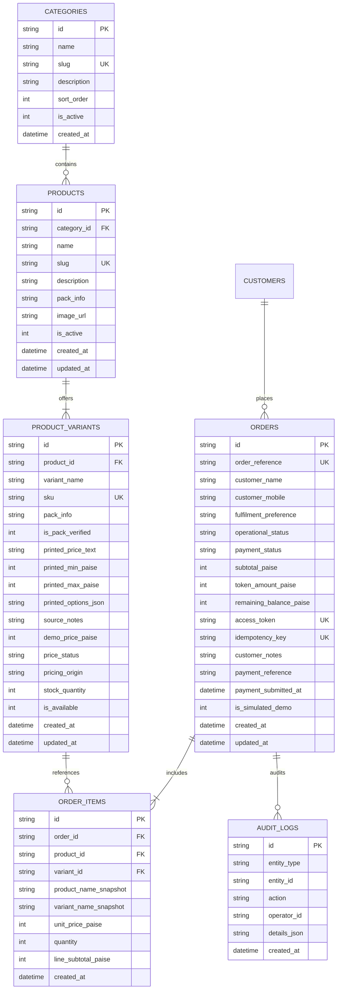

# NAGARJUNA TRADERS — DATA MODEL SPECIFICATION

**Document Reference:** `docs/data-model.md`  
**Database Engine:** Cloudflare D1 (Serverless Distributed SQLite)  
**Currency Units:** Integer Paise (₹1 = 100 paise; no floating-point arithmetic)  
**Integrity Level:** Foreign Keys Enabled (`PRAGMA foreign_keys = ON;`)

---

## 1. Relational Entity Relationship Diagram



---

## 2. Table Definitions & DDL Scripts

### 2.1 `categories`
```sql
CREATE TABLE IF NOT EXISTS categories (
    id TEXT PRIMARY KEY,
    name TEXT NOT NULL,
    slug TEXT NOT NULL UNIQUE,
    description TEXT,
    sort_order INTEGER NOT NULL DEFAULT 0,
    is_active INTEGER NOT NULL DEFAULT 1,
    created_at TEXT NOT NULL DEFAULT (datetime('now'))
);
```

### 2.2 `products`
```sql
CREATE TABLE IF NOT EXISTS products (
    id TEXT PRIMARY KEY,
    category_id TEXT NOT NULL REFERENCES categories(id) ON DELETE RESTRICT,
    name TEXT NOT NULL,
    slug TEXT NOT NULL UNIQUE,
    description TEXT,
    pack_info TEXT,
    image_url TEXT,
    is_active INTEGER NOT NULL DEFAULT 1,
    created_at TEXT NOT NULL DEFAULT (datetime('now')),
    updated_at TEXT NOT NULL DEFAULT (datetime('now'))
);
```

### 2.3 `product_variants`
```sql
CREATE TABLE IF NOT EXISTS product_variants (
    id TEXT PRIMARY KEY,
    product_id TEXT NOT NULL REFERENCES products(id) ON DELETE CASCADE,
    variant_name TEXT NOT NULL,
    sku TEXT NOT NULL UNIQUE,
    pack_info TEXT,
    is_pack_verified INTEGER NOT NULL DEFAULT 0,
    printed_price_text TEXT NOT NULL,
    printed_min_paise INTEGER,                -- Nullable minimum printed boundary in paise
    printed_max_paise INTEGER,                -- Nullable maximum printed boundary in paise
    printed_options_json TEXT,                -- Nullable JSON array of discrete printed options [paise, ...]
    source_notes TEXT,                        -- Verbatim poster notes & confirmation requirements
    demo_price_paise INTEGER,                 -- Nullable active demo price in paise (null if unresolved)
    price_status TEXT NOT NULL DEFAULT 'PRINTED_ESTIMATE'
        CHECK (price_status IN ('PRINTED_ESTIMATE', 'PRICE_ON_ENQUIRY', 'CONFIRMED')),
    pricing_origin TEXT NOT NULL
        CHECK (pricing_origin IN ('POSTER_EXACT', 'POSTER_RANGE', 'UNCONFIRMED_MAPPING', 'DEMO_NUMERIC', 'OWNER_CONFIRMED')),
    stock_quantity INTEGER NOT NULL DEFAULT 100 CHECK (stock_quantity >= 0),
    is_available INTEGER NOT NULL DEFAULT 1,
    created_at TEXT NOT NULL DEFAULT (datetime('now')),
    updated_at TEXT NOT NULL DEFAULT (datetime('now'))
);
CREATE INDEX IF NOT EXISTS idx_variants_product ON product_variants(product_id);
CREATE INDEX IF NOT EXISTS idx_variants_sku ON product_variants(sku);
```

### 2.4 `orders` (formerly `demo_orders`)
```sql
CREATE TABLE IF NOT EXISTS orders (
    id TEXT PRIMARY KEY,
    order_reference TEXT NOT NULL UNIQUE,      -- Format: NT-XXXX
    customer_name TEXT NOT NULL,
    customer_mobile TEXT NOT NULL CHECK (length(customer_mobile) = 10),
    fulfilment_preference TEXT NOT NULL DEFAULT 'COUNTER_PICKUP'
        CHECK (fulfilment_preference IN ('COUNTER_PICKUP', 'SPECIAL_ENQUIRY')),
    operational_status TEXT NOT NULL DEFAULT 'SUBMITTED' 
        CHECK (operational_status IN ('SUBMITTED', 'CONFIRMED', 'PREPARING', 'READY_FOR_PICKUP', 'COMPLETED', 'CANCELLED')),
    payment_status TEXT NOT NULL DEFAULT 'UNPAID'
        CHECK (payment_status IN ('UNPAID', 'RECORDED_UNVERIFIED', 'FAILED')),
    subtotal_paise INTEGER NOT NULL CHECK (subtotal_paise >= 5000), -- Minimum order threshold: ₹50 (5,000 paise)
    token_amount_paise INTEGER NOT NULL,       -- Strict Tier Rule: < ₹200 -> strictly ₹50 (5,000 paise); >= ₹200 -> strictly ₹100 (10,000 paise)
    remaining_balance_paise INTEGER NOT NULL CHECK (remaining_balance_paise >= 0),
    access_token TEXT NOT NULL UNIQUE,         -- Secret cryptographic UUID passed in X-Order-Token header
    idempotency_key TEXT UNIQUE,
    customer_notes TEXT,
    payment_reference TEXT UNIQUE,             -- Exactly 12 numeric digits string UTR
    payment_submitted_at TEXT,
    is_simulated_demo INTEGER NOT NULL DEFAULT 1,
    created_at TEXT NOT NULL DEFAULT (datetime('now')),
    updated_at TEXT NOT NULL DEFAULT (datetime('now'))
);
CREATE INDEX IF NOT EXISTS idx_orders_ref ON orders(order_reference);
CREATE INDEX IF NOT EXISTS idx_orders_op_status ON orders(operational_status);
CREATE INDEX IF NOT EXISTS idx_orders_pay_status ON orders(payment_status);
CREATE INDEX IF NOT EXISTS idx_orders_created_at ON orders(created_at DESC);
```

### 2.5 `order_items` (Frozen Historical Snapshots)
```sql
CREATE TABLE IF NOT EXISTS order_items (
    id TEXT PRIMARY KEY,
    order_id TEXT NOT NULL REFERENCES orders(id) ON DELETE CASCADE,
    product_id TEXT NOT NULL,
    variant_id TEXT NOT NULL,
    product_name_snapshot TEXT NOT NULL,
    variant_name_snapshot TEXT NOT NULL,
    unit_price_paise INTEGER NOT NULL CHECK (unit_price_paise > 0),
    quantity INTEGER NOT NULL CHECK (quantity > 0 AND quantity <= 50),
    line_subtotal_paise INTEGER NOT NULL CHECK (line_subtotal_paise > 0),
    created_at TEXT NOT NULL DEFAULT (datetime('now'))
);
CREATE INDEX IF NOT EXISTS idx_order_items_order ON order_items(order_id);
```

### 2.6 `price_audit_logs`
```sql
CREATE TABLE IF NOT EXISTS price_audit_logs (
    id TEXT PRIMARY KEY,
    entity_type TEXT NOT NULL CHECK (entity_type IN ('VARIANT_PRICE', 'ORDER_STATUS', 'SYSTEM_SETTING')),
    entity_id TEXT NOT NULL,
    action TEXT NOT NULL,
    operator_id TEXT NOT NULL,
    old_value_json TEXT,
    new_value_json TEXT,
    reason TEXT,
    is_override INTEGER NOT NULL DEFAULT 0,
    created_at TEXT NOT NULL DEFAULT (datetime('now'))
);
CREATE INDEX IF NOT EXISTS idx_audit_logs_entity ON price_audit_logs(entity_type, entity_id);
```

---

## 3. Tiered Token Calculation Specification

The tiered token calculation rule is implemented as a single, pure deterministic function shared across client and server:

```typescript
export const TOKEN_TIER_THRESHOLD_PAISE = 20000; // ₹200.00
export const TOKEN_LOW_TIER_PAISE = 5000;        // ₹50.00
export const TOKEN_HIGH_TIER_PAISE = 10000;      // ₹100.00

export function calculateTokenAmountPaise(subtotalPaise: number): number {
  if (subtotalPaise <= 0) return 0;
  if (subtotalPaise < TOKEN_TIER_THRESHOLD_PAISE) {
    // Safe rule for subtotals below ₹50: token never exceeds subtotal
    return Math.min(subtotalPaise, TOKEN_LOW_TIER_PAISE);
  }
  return TOKEN_HIGH_TIER_PAISE;
}

export function calculateRemainingBalancePaise(
  subtotalPaise: number,
  tokenAmountPaise: number
): number {
  return Math.max(0, subtotalPaise - tokenAmountPaise);
}
```

### Verification Matrix:
- Subtotal ₹30 $\rightarrow$ Token ₹30, Remaining Balance ₹0.
- Subtotal ₹60 $\rightarrow$ Token ₹50, Remaining Balance ₹10.
- Subtotal ₹150 $\rightarrow$ Token ₹50, Remaining Balance ₹100.
- Subtotal ₹199 $\rightarrow$ Token ₹50, Remaining Balance ₹149.
- Subtotal ₹200 (Exact boundary) $\rightarrow$ Token ₹100, Remaining Balance ₹100.
- Subtotal ₹350 $\rightarrow$ Token ₹100, Remaining Balance ₹250.
- Subtotal ₹1,000 $\rightarrow$ Token ₹100, Remaining Balance ₹900.
