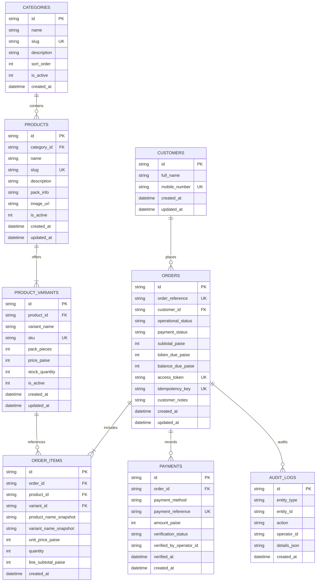

# NAGARJUNA TRADERS — DATA MODEL SPECIFICATION

**Document Reference:** `docs/data-model.md`  
**Database Engine:** Cloudflare D1 (Serverless Distributed SQLite)  
**Currency Units:** Integer Paise (₹1 = 100 paise; no floating-point arithmetic)  
**Integrity Level:** Foreign Keys Enabled (`PRAGMA foreign_keys = ON;`)

---

## 1. Relational Entity Relationship Diagram



---

## 2. Table Definitions & DDL Scripts

### 2.1 `categories`
```sql
CREATE TABLE IF NOT EXISTS categories (
    id TEXT PRIMARY KEY,
    name TEXT NOT NULL,
    slug TEXT NOT NULL UNIQUE,
    description TEXT,
    sort_order INTEGER NOT NULL DEFAULT 0,
    is_active INTEGER NOT NULL DEFAULT 1,
    created_at TEXT NOT NULL DEFAULT (datetime('now'))
);
```

### 2.2 `products`
```sql
CREATE TABLE IF NOT EXISTS products (
    id TEXT PRIMARY KEY,
    category_id TEXT NOT NULL REFERENCES categories(id) ON DELETE RESTRICT,
    name TEXT NOT NULL,
    slug TEXT NOT NULL UNIQUE,
    description TEXT,
    pack_info TEXT,
    image_url TEXT,
    is_active INTEGER NOT NULL DEFAULT 1,
    created_at TEXT NOT NULL DEFAULT (datetime('now')),
    updated_at TEXT NOT NULL DEFAULT (datetime('now'))
);
```

### 2.3 `product_variants`
```sql
CREATE TABLE IF NOT EXISTS product_variants (
    id TEXT PRIMARY KEY,
    product_id TEXT NOT NULL REFERENCES products(id) ON DELETE CASCADE,
    variant_name TEXT NOT NULL,
    sku TEXT NOT NULL UNIQUE,
    pack_pieces INTEGER,
    price_paise INTEGER NOT NULL CHECK (price_paise > 0),
    stock_quantity INTEGER NOT NULL DEFAULT 0 CHECK (stock_quantity >= 0),
    is_active INTEGER NOT NULL DEFAULT 1,
    created_at TEXT NOT NULL DEFAULT (datetime('now')),
    updated_at TEXT NOT NULL DEFAULT (datetime('now'))
);
```

### 2.4 `customers`
```sql
CREATE TABLE IF NOT EXISTS customers (
    id TEXT PRIMARY KEY,
    full_name TEXT NOT NULL,
    mobile_number TEXT NOT NULL CHECK (length(mobile_number) = 10),
    created_at TEXT NOT NULL DEFAULT (datetime('now')),
    updated_at TEXT NOT NULL DEFAULT (datetime('now'))
);
CREATE INDEX IF NOT EXISTS idx_customers_mobile ON customers(mobile_number);
```

### 2.5 `orders`
```sql
CREATE TABLE IF NOT EXISTS orders (
    id TEXT PRIMARY KEY,
    order_reference TEXT NOT NULL UNIQUE, -- Formatted: NT-2026-XXXXXX
    customer_id TEXT NOT NULL REFERENCES customers(id) ON DELETE RESTRICT,
    operational_status TEXT NOT NULL DEFAULT 'SUBMITTED' 
        CHECK (operational_status IN ('SUBMITTED', 'CONFIRMED', 'PREPARING', 'READY_FOR_PICKUP', 'COMPLETED', 'CANCELLED', 'EXPIRED')),
    payment_status TEXT NOT NULL DEFAULT 'UNPAID'
        CHECK (payment_status IN ('UNPAID', 'PENDING_VERIFICATION', 'VERIFIED_TOKEN', 'VERIFIED_FULL', 'FAILED', 'REFUNDED')),
    subtotal_paise INTEGER NOT NULL CHECK (subtotal_paise > 0),
    token_due_paise INTEGER NOT NULL CHECK (token_due_paise >= 0),
    balance_due_paise INTEGER NOT NULL CHECK (balance_due_paise >= 0),
    access_token TEXT NOT NULL UNIQUE, -- Secret cryptographic UUID for customer order URL lookup
    idempotency_key TEXT UNIQUE,
    customer_notes TEXT,
    created_at TEXT NOT NULL DEFAULT (datetime('now')),
    updated_at TEXT NOT NULL DEFAULT (datetime('now'))
);
CREATE INDEX IF NOT EXISTS idx_orders_ref ON orders(order_reference);
CREATE INDEX IF NOT EXISTS idx_orders_op_status ON orders(operational_status);
CREATE INDEX IF NOT EXISTS idx_orders_pay_status ON orders(payment_status);
CREATE INDEX IF NOT EXISTS idx_orders_created_at ON orders(created_at DESC);
```

### 2.6 `order_items` (Frozen Historical Snapshots)
```sql
CREATE TABLE IF NOT EXISTS order_items (
    id TEXT PRIMARY KEY,
    order_id TEXT NOT NULL REFERENCES orders(id) ON DELETE CASCADE,
    product_id TEXT NOT NULL REFERENCES products(id),
    variant_id TEXT NOT NULL REFERENCES product_variants(id),
    product_name_snapshot TEXT NOT NULL,
    variant_name_snapshot TEXT NOT NULL,
    unit_price_paise INTEGER NOT NULL CHECK (unit_price_paise > 0),
    quantity INTEGER NOT NULL CHECK (quantity > 0 AND quantity <= 50),
    line_subtotal_paise INTEGER NOT NULL CHECK (line_subtotal_paise > 0),
    created_at TEXT NOT NULL DEFAULT (datetime('now'))
);
CREATE INDEX IF NOT EXISTS idx_order_items_order_id ON order_items(order_id);
```

### 2.7 `payments`
```sql
CREATE TABLE IF NOT EXISTS payments (
    id TEXT PRIMARY KEY,
    order_id TEXT NOT NULL REFERENCES orders(id) ON DELETE RESTRICT,
    payment_method TEXT NOT NULL DEFAULT 'UPI' CHECK (payment_method IN ('UPI', 'CASH_AT_COUNTER')),
    payment_reference TEXT UNIQUE, -- 12-digit UTR from customer or bank
    amount_paise INTEGER NOT NULL CHECK (amount_paise > 0),
    verification_status TEXT NOT NULL DEFAULT 'PENDING'
        CHECK (verification_status IN ('PENDING', 'VERIFIED', 'REJECTED')),
    verified_by_operator_id TEXT,
    verified_at TEXT,
    created_at TEXT NOT NULL DEFAULT (datetime('now'))
);
CREATE INDEX IF NOT EXISTS idx_payments_order ON payments(order_id);
CREATE INDEX IF NOT EXISTS idx_payments_ref ON payments(payment_reference);
```

### 2.8 `audit_logs`
```sql
CREATE TABLE IF NOT EXISTS audit_logs (
    id TEXT PRIMARY KEY,
    entity_type TEXT NOT NULL, -- 'ORDER', 'PRODUCT', 'PAYMENT', 'STOCK'
    entity_id TEXT NOT NULL,
    action TEXT NOT NULL,      -- 'STATUS_CHANGE', 'PRICE_EDIT', 'VERIFY_PAYMENT'
    operator_id TEXT NOT NULL,
    details_json TEXT NOT NULL,
    created_at TEXT NOT NULL DEFAULT (datetime('now'))
);
CREATE INDEX IF NOT EXISTS idx_audit_entity ON audit_logs(entity_type, entity_id);
```

---

## 3. Financial Calculation Invariants

1. **Paise Integrity:** Every calculation follows:
   $$\text{line\_subtotal\_paise} = \text{unit\_price\_paise} \times \text{quantity}$$
   $$\text{subtotal\_paise} = \sum_{i} \text{line\_subtotal\_paise}_i$$
   $$\text{token\_due\_paise} = \max\left(10000, \left\lceil \text{subtotal\_paise} \times 0.20 \right\rceil\right)$$
   $$\text{balance\_due\_paise} = \text{subtotal\_paise} - \text{verified\_amount\_paise}$$
2. **Zero Inconsistent State:** The sum of `order_items.line_subtotal_paise` must exactly equal `orders.subtotal_paise`. Checked via server-side database transaction before final commit.
