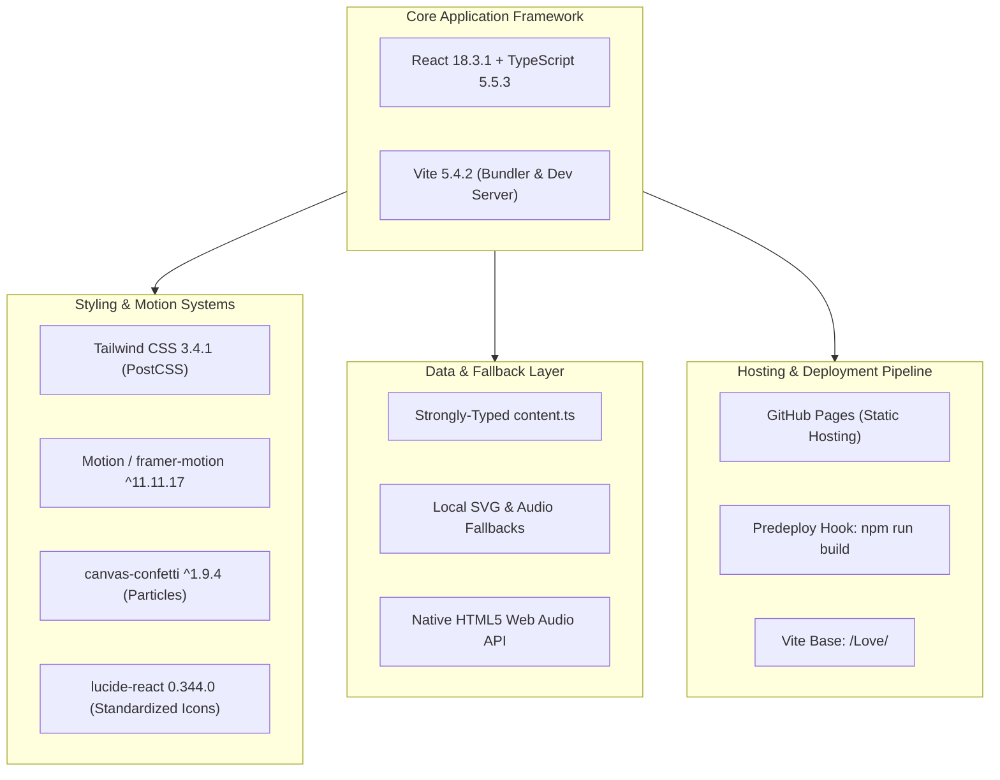
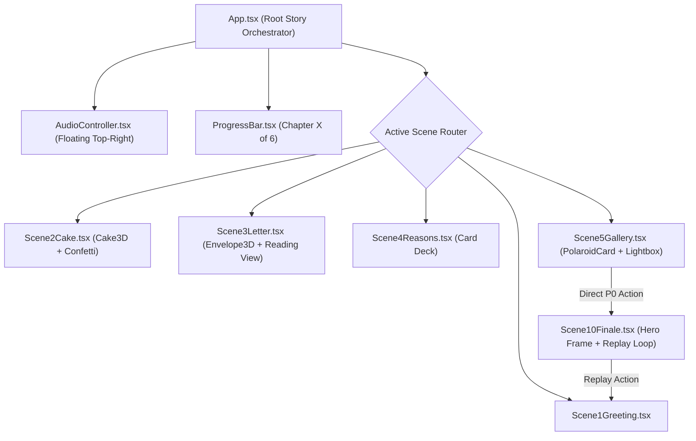

# Technical Architecture & System Design

**Project:** Girlfriend Birthday Website  
**Repository Target:** `bedant1424/Love`  
**Deployment Target:** GitHub Pages (`https://bedant1424.github.io/Love/`)  
**Architecture Pattern:** Mobile-First Static Single-Page Storytelling Application (SPA)  
**Backend Requirements:** None (Zero Cloud Database, Zero External APIs, Zero User Accounts)  

---

## 1. Technical Stack Specification (Exact Repository Alignment)

The technical stack strictly aligns with the existing dependencies on `origin/main` without unnecessary version upgrades:



### Exact Dependencies Manifest
```json
{
  "dependencies": {
    "react": "^18.3.1",
    "react-dom": "^18.3.1",
    "lucide-react": "^0.344.0",
    "motion": "^11.11.17",
    "canvas-confetti": "^1.9.4"
  },
  "devDependencies": {
    "@types/react": "^18.3.5",
    "@types/react-dom": "^18.3.0",
    "@types/canvas-confetti": "^1.9.0",
    "@vitejs/plugin-react": "^4.3.1",
    "autoprefixer": "^10.4.18",
    "postcss": "^8.4.35",
    "tailwindcss": "^3.4.1",
    "typescript": "^5.5.3",
    "vite": "^5.4.2",
    "gh-pages": "^6.3.0"
  }
}
```

---

## 2. P0 Component Architecture & Hierarchy

In the launch-critical P0 flow, only 6 active scenes are rendered, with Scene 5 directly routing to Scene 10:



### Component Responsibilities
1. **`App.tsx`:** Manages global state (`currentSceneIndex`, `themeMode`: `'light' | 'cinematic'`), synchronizes URL hash (`#scene-1` to `#scene-10`), and wraps active scenes in Motion's `AnimatePresence`.
2. **`AudioController.tsx`:** Floating audio player. Guarantees zero playback until explicit user interaction on Scene 1; provides instant mute/unmute toggle.
3. **`Cake3D.tsx`:** Renders layered SVG cake, flame flickering keyframes, listens for tap-to-extinguish, fires canvas confetti bursts, and spawns rising smoke particles.
4. **`Envelope3D.tsx`:** Coordinates 3D flap fold animation (`rotateX: 180deg`), wax seal breaking effect, and letter sheet expansion.
5. **`PolaroidCard.tsx` & `Lightbox.tsx`:** Renders photo cards with organic tilt angles; includes local SVG papercraft illustration fallback if image paths are missing; opens swipeable modal viewer on tap.

---

## 3. GitHub Pages Hosting & Deployment Pipeline

Hosting on GitHub Pages (`https://bedant1424.github.io/Love/`) introduces specific deployment rules:

### 3.1 Vite Base Path Configuration
`vite.config.ts` must maintain:
```typescript
import { defineConfig } from 'vite'
import react from '@vitejs/plugin-react'

export default defineConfig({
  plugins: [react()],
  base: '/Love/', // Crucial for bedant1424.github.io/Love/
})
```

### 3.2 Predeploy Hook Requirement (Milestone 1 Implementation Task)
In `package.json`, the existing script is `"deploy": "gh-pages -d dist"`, which pushes the `dist/` directory but **does not build it**. The documentation-only phase does not modify application files. During Milestone 1 implementation, adding a `predeploy` script to `package.json` is required:

```json
"scripts": {
  "dev": "vite",
  "build": "tsc -b && vite build",
  "preview": "vite preview",
  "typecheck": "tsc --noEmit -p tsconfig.app.json",
  "predeploy": "npm run build",
  "deploy": "gh-pages -d dist"
}
```

Once configured in Milestone 1, running `npm run deploy` will:
1. Automatically execute `predeploy` (`npm run build`).
2. Typecheck with TypeScript and compile optimized bundles to `dist/`.
3. Push `dist/` to the `gh-pages` branch on GitHub. (Manual fallback before Milestone 1: run `npm run build && npm run deploy`).

### 3.3 Routing Strategy
Hash-based navigation (`#scene-1`, `#scene-2`, `#scene-10`) is used instead of HTML5 History pushState. This guarantees that refreshing the page at `https://bedant1424.github.io/Love/#scene-3` will never trigger a GitHub Pages 404 error.

---

## 4. Media & Asset Fallback Architecture

1. **Photo Fallbacks:**
   - Photos reside in `public/photos/` in WebP format.
   - If an image file is missing or fails to load (`onError` handler), the component renders an inline SVG papercraft card (pastel birthday cake, heart cluster, starry night) with the memory caption, avoiding broken image boxes or mismatched stock photos.
2. **Audio Fallbacks:**
   - Audio resides in `public/audio/`.
   - If no audio file is provided, a gentle bundled acoustic piano chime plays, or sound initializes in muted mode without console errors.
