# Implementation & Delivery Plan

**Project:** Girlfriend Birthday Website  
**Deadline:** Under 24 Hours (Birthday is Tomorrow)  
**Execution Strategy:** Milestone-Driven, P0-First, Timeboxed Verification  
**Phase Transition:** Ready for Implementation Execution upon User Approval  

---

## 1. 24-Hour Execution Timeline & Launch Strategy

With the birthday occurring tomorrow, time is the primary project constraint. The implementation plan is structured to guarantee that a fully functional, emotionally complete, and polished P0 website is deployed and verified hours before the birthday morning.

```mermaid
gantt
    title 24-Hour Implementation & Launch Schedule
    dateFormat  HH:mm
    axisFormat %H:%M

    section Milestone 1: Scaffolding
    Vite/React 18/Tailwind 3.4 Baseline     :m1_1, 00:00, 1h
    Design Tokens & Content Schema           :m1_2, after m1_1, 1h

    section Milestone 2: P0 Core Flow
    Scene 1 Greeting & Audio Controller     :m2_1, after m1_2, 1h
    Scene 2 Cake & Candle Extinguish        :m2_2, after m2_1, 1.5h
    Scene 3 3D Love Letter Envelope         :m2_3, after m2_2, 1.5h
    Scene 4 Reasons I Love You Deck         :m2_4, after m2_3, 1h
    Scene 5 Gallery & Scene 10 Direct Route :m2_5, after m2_4, 1.5h
    Scene 10 Finale & Replay Loop           :m2_6, after m2_5, 1h

    section Milestone 3: P0 Launch Gate
    Build, Predeploy & Mobile QA            :m3_1, after m2_6, 1.5h
    LAUNCH CUTOFF CHECKPOINT (P0 Ready)     :milestone, after m3_1, 0h

    section Milestone 4: P1/P2 Enhancements
    Scene 6 Timeline & Scene 8 Gifts (P1)   :m4_1, after m3_1, 2h
    Scene 7 Quiz & Scene 9 Coupons (P2)     :m4_2, after m4_1, 1.5h
    Final Production Deploy & Verification   :m4_3, after m4_2, 1h
```

---

## 2. Detailed Milestone Breakdown

### Milestone 1: Scaffolding & Configuration Alignment
- **Goal:** Establish a pristine, error-free Vite + React 18 + Tailwind 3.4 workspace with exact dependencies matching the repository baseline.
- **Estimated Effort:** 2.0 Hours
- **Tasks:**
  1. Work on branch `feature/birthday-website-spec` (rooted in `origin/main`).
  2. Setup `package.json` dependencies:
     - `react: ^18.3.1`, `react-dom: ^18.3.1`, `lucide-react: ^0.344.0`
     - `motion: ^11.11.17`, `canvas-confetti: ^1.9.4`, `@types/canvas-confetti: ^1.9.0`
     - `tailwindcss: ^3.4.1`, `postcss: ^8.4.35`, `autoprefixer: ^10.4.18`
     - `vite: ^5.4.2`, `typescript: ^5.5.3`, `gh-pages: ^6.3.0`
  3. Add `"predeploy": "npm run build"` to `package.json` scripts (required to automate build before publish in Milestone 1).
  4. Verify `base: '/Love/'` in `vite.config.ts`.
  5. Setup `tailwind.config.js` with semantic tokens (`rose-CTA: #C2315D`, `lavender-CTA: #7A4AC2`, `cream-50: #FAF7F2`, `plum-950: #160B1F`) and typography font families.
  6. Create `src/data/content.ts` with publication-safe default copy and SVG fallback definitions.

---

### Milestone 2: P0 Core Launch Experience (6 Active Chapters)
- **Goal:** Implement the 6 launch-critical scenes, global audio player, and navigation shell with direct Scene 5 → Scene 10 routing.
- **Estimated Effort:** 7.5 Hours
- **Dependencies:** Milestone 1 complete.
- **Tasks:**
  1. **Global Shell & Navigation (`App.tsx`):**
     - Build layout with dynamic background transitions (light lavender/cream vs. midnight plum).
     - Implement floating `AudioController.tsx` with user-gesture playback and mute toggle.
     - Implement `ProgressBar.tsx` displaying `"Chapter X of 6"`.
  2. **Scene 1 (Opening Greeting):**
     - Romantic greeting typography, floating ambient SVG hearts, invitation card, and primary "Begin Our Story" CTA.
  3. **Scene 2 (The Birthday Moment & Cake):**
     - Dark cinematic atmosphere transition (`#160B1F`).
     - Conditional countdown / celebratory header.
     - Render multi-tier cake with flickering SVG candle flame.
     - Tap-to-blow extinguish interaction: flame extinguishes, rising smoke curl, chime audio, and `canvas-confetti` explosion.
  4. **Scene 3 (3D Love Letter Reveal):**
     - Interactive 3D envelope with golden wax seal.
     - 3D flap fold animation (`rotateX: 180deg`) and sliding letter transition.
     - High-contrast, readable parchment letter view (`#2D2635` on `#FAF7F2`) with smooth scroll container and sign-off.
  5. **Scene 4 (Reasons I Love You):**
     - Interactive deck of 6 heart-badged compliment cards with tap-to-reveal interaction and progress counter.
  6. **Scene 5 (Memories Gallery & Lightbox):**
     - Polaroid scrapbook cards with organic tilt angles, white borders, washi tape, and handwritten captions.
     - Accessible modal lightbox with swipe gestures, keyboard arrows, and close button.
     - Illustrated SVG fallback cards if photos are missing.
     - **P0 Direct Route CTA:** Button at bottom reads `"See Your Birthday Finale ✨"` and navigates directly to Scene 10.
  7. **Scene 10 (Grand Finale & Replay):**
     - Midnight plum hero frame, romantic closing declaration, celebratory confetti cascade, and `"Replay Our Story 🔄"` button.

---

### Milestone 3: P0 Verification & Safe Launch Gate (HARD CUTOFF)
- **Goal:** Dry-run the production build, audit mobile responsiveness, and deploy P0 directly to GitHub Pages.
- **Estimated Effort:** 1.5 Hours
- **Dependencies:** Milestone 2 complete.
- **Launch Gate Rule:** *If total remaining time before the birthday is under 4 hours, STOP adding features. Ship P0 immediately to GitHub Pages.*
- **Tasks:**
  1. Run `npm run typecheck` and `npm run build` to verify clean production bundles.
  2. Verify bundle size (<250KB gzipped) and image loading performance.
  3. Conduct responsive checks on mobile viewports (320px, 375px, 430px) and desktop.
  4. Test audio autoplay safety across iOS Safari and Chrome.
  5. Deploy P0 to GitHub Pages via `npm run deploy` (automatically triggers `predeploy` build).
  6. Verify live deployment at `https://bedant1424.github.io/Love/`.

---

### Milestone 4: P1 & P2 Enhancements (Post-P0 Buffer)
- **Goal:** Add extra emotional depth and playful gamification if time permits before the final cutoff.
- **Estimated Effort:** 4.5 Hours
- **Dependencies:** Milestone 3 verified and deployed.
- **Tasks:**
  1. **Scene 6 (Relationship Timeline - P1):** Milestone track with dates and stories.
  2. **Scene 8 (Surprise Gifts - P1):** 3 spring-lid gift boxes with unboxing animations and custom reward cards.
  3. **Scene 7 (Relationship Quiz - P2):** Multiple-choice trivia cards with humorous feedback.
  4. **Scene 9 (Love Coupons & Playlist - P2):** Redeemable coupons and playlist embed.
  5. Progress bar automatically updates from 6 to 8 or 10 chapters.
  6. Re-run deployment pipeline: `npm run deploy`.

---

## 3. Explicit Launch Cutoffs Table

| Hours Remaining | Action & Decision Rule |
| :--- | :--- |
| **> 12 Hours** | Execute standard schedule: Milestones 1, 2, 3, then proceed to P1 features (Timeline & Gifts). |
| **6 – 12 Hours** | Complete Milestone 2 (P0 scenes), skip P2 features entirely; execute Milestone 3 launch gate immediately. |
| **< 4 Hours (Emergency Gate)** | **FREEZE SCOPE IMMEDIATELY.** Deploy active P0 build to GitHub Pages. Do not touch new components. Dedicate all remaining time to content verification. |
