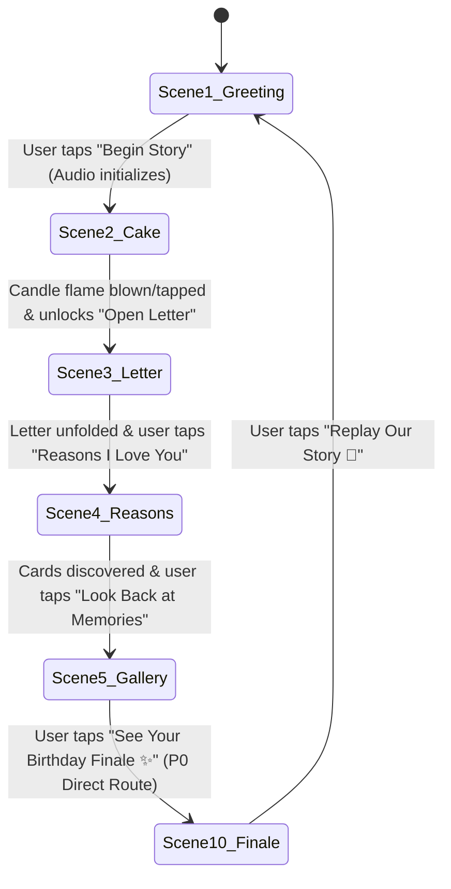

# Interaction & Behavioral Specification

**Project:** Girlfriend Birthday Website  
**Focus:** Scene State Machines, Gestures, Physical Animation Specs, Accessibility & Error Handling  
**Document Status:** Complete & Verified  

---

## 1. Global Navigation & Story Flow State Machine

The website operates as a continuous, linear storytelling journey. To guarantee a zero-dead-end, complete experience under the 24-hour deadline, the primary P0 release is structured as an exact 6-chapter sequence:



### 1.1 Direct Route from Scene 5 to Scene 10 in P0
- When optional Scenes 6–9 are not active, Scene 5 (Memories Gallery) features an explicit, prominent primary action button: `"See Your Birthday Finale ✨"`.
- Clicking this button transitions immediately into Scene 10 (Grand Finale).
- **No Dead Ends:** The user is never presented with disabled controls, missing chapters, or unclickable dead ends.

### 1.2 Dynamic Chapter Progress Display
- The bottom chapter pill dynamically reflects the count of active scenes:
  - **In P0 Mode:** Displays `"Chapter 1 of 6"`, `"Chapter 2 of 6"`, ... `"Chapter 6 of 6"` (where Chapter 6 maps to Scene 10).
  - **In P1 Mode (Scenes 6 & 8 active):** Displays `"Chapter X of 8"`.
  - **In Full Mode (All 10 active):** Displays `"Chapter X of 10"`.
- It contains zero references to inactive or skipped scenes.
- Tapping any previously viewed chapter step allows smooth backward navigation without resetting discovered states.

### 1.3 Preservation of Original Scene IDs
In the codebase, component filenames and router tokens strictly preserve original Scene IDs:
- `Scene1Greeting.tsx`
- `Scene2Cake.tsx`
- `Scene3Letter.tsx`
- `Scene4Reasons.tsx`
- `Scene5Gallery.tsx`
- `Scene6Timeline.tsx` (P1)
- `Scene7Quiz.tsx` (P2)
- `Scene8Gifts.tsx` (P1)
- `Scene9Coupons.tsx` (P2)
- `Scene10Finale.tsx`

This ensures that adding P1 or P2 components requires zero renaming or router refactoring.

---

## 2. Component Interaction Specifications

### 2.1 Audio Controller & Music Playback
- **Browser Autoplay Compliance:** Modern mobile browsers (iOS Safari and Android Chrome) strictly prohibit unprompted audio autoplay.
- **Trigger Gesture:** Audio initializes exclusively when the user interacts with the Scene 1 primary button ("Begin Our Story ✨").
- **UI Element:** A fixed floating circle (`44x44px`) in the top-right corner (`top-4 right-4 z-50`).
- **States:**
  - `Playing`: Music note icon with soft glowing lavender ring and CSS wave pulse animation.
  - `Muted / Paused`: Speaker with slash (`VolumeX`) icon; pulse stops.
- **Tap Action:** Instant toggle of audio playback (`audio.play()` / `audio.pause()`) with zero lag or popping audio artifacts.
- **Fallback:** If no custom audio track is provided, the player uses a bundled acoustic piano chime or disables cleanly without console 404 errors.

---

### 2.2 Scene 2: Birthday Cake & Candle Extinguish Interaction
- **Initial State:**
  - Ambient screen background shifts from warm cream into Midnight Plum (`#160B1F`) over 800ms.
  - Multi-tiered cake sits centered on a cream pedestal.
  - Golden candle flame flickers naturally with randomized translation and scale keyframes:
    ```css
    @keyframes flicker {
      0% { transform: scale(1) rotate(-1deg); opacity: 0.95; }
      50% { transform: scale(1.1) rotate(1deg); opacity: 1; }
      100% { transform: scale(0.95) rotate(-0.5deg); opacity: 0.9; }
    }
    ```
- **Extinguish Triggers:**
  - **Primary Trigger (100% Reliable):** Tapping or clicking the flame or candle element directly (`min-w-[60px] min-h-[60px]` touch area).
  - **Secondary (Optional P2 Microphone Trigger):** Web Audio API microphone volume analysis. If permission is granted and input volume crosses threshold (>40/100) for 400ms, triggers extinguish. If permission is denied, silently defaults to tap.
- **Execution Sequence:**
  1. Flame opacity and scale animate to 0 over 150ms.
  2. Audio cue: Soft "whoosh / puff" audio chime plays.
  3. SVG smoke particle appears at candle wick and rises `translateY(-60px)` while fading to 0 over 1200ms.
  4. Confetti burst fires: `canvas-confetti` launches a 100-particle explosion from coordinates `(x: 50%, y: 45%)`.
  5. Subheading copy morphs from *"Make a wish and tap the flame!"* to *"✨ Wish locked in! May all your dreams come true!"*.
  6. Primary button *"Open Your Birthday Letter 💌"* transitions from hidden to visible with an accessible Berry Rose CTA (`#C2315D`).

---

### 2.3 Scene 3: 3D Love Letter Envelope Reveal
- **Initial State:** Closed physical envelope positioned in screen center (`width: 320px`, `height: 220px`). Golden wax seal button sits over the triangular flap tip.
- **Interaction (Tap Seal or Envelope):**
  1. Haptic feedback triggered on supported mobile devices (`navigator.vibrate?.(20)`).
  2. Audio cue: Gentle paper rustle / unseal sound effect.
  3. Flap folds upward using CSS 3D: `transform: rotateX(180deg)` with `transform-origin: top center` over 500ms (`cubic-bezier(0.4, 0, 0.2, 1)`).
  4. Internal folded parchment sheet translates upward `translateY(-80px)` and scales to emerge from the pocket.
  5. The letter expands smoothly into a focused, readable paper modal with warm parchment background (`#FAF7F2`), clean dark plum typography (`#2D2635`, 13.64:1 contrast), and delicate floral border.
- **Scroll & Read Behavior:**
  - The reading modal features an internal scroll container with smooth momentum scrolling (`-webkit-overflow-scrolling: touch`).
  - Font size is locked at 18px (`1.125rem`) with 1.6 line height for comfortable reading.
- **Close / Proceed Controls:**
  - Secondary button: *"Fold Letter ✉️"* (returns to closed state).
  - Primary button: *"Reasons Why I Love You 💖"* (advances to Scene 4).

---

### 2.4 Scene 4: Reasons I Love You Cards
- **Layout:** Responsive grid (1-column on mobile, 2-column on tablet, 3-column on desktop).
- **Card States:**
  - `Default (Unopened)`: Shows card number, heart icon, and teaser heading.
  - `Flipped / Expanded`: On tap, card executes a 3D flip (`rotateY(180deg)`) or spring-expands to reveal the detailed heartfelt narrative.
- **Progress Counter:** Header updates dynamically (e.g., *"6 of 6 reasons discovered"*). Once all cards have been tapped, a tiny shower of star confetti sparkles above the header.

---

### 2.5 Scene 5: Memories Gallery & Accessible Lightbox
- **Gallery Grid:** Stacked Polaroid cards with staggered organic tilt angles (`-3deg` to `+3deg`) and realistic paper shadows.
- **Image Fallback:** If photos are missing, renders charming illustrated SVG papercraft cards.
- **Lightbox Opening Sequence:**
  1. Tapping any Polaroid expands the image into a high-resolution lightbox modal overlay (`z-index: 100`).
  2. Background scrim dims to `rgba(22, 11, 31, 0.85)` with backdrop blur.
  3. Modal displays: High-res photo or illustration, date pill, full caption narrative, close button (`✕`), and next/previous chevron buttons.
- **Mobile Touch Gestures:**
  - Horizontal swipe left: Advances to next photo.
  - Horizontal swipe right: Returns to previous photo.
  - Swipe down or tap scrim: Dismisses lightbox.
- **Keyboard & Accessibility Controls:**
  - `Escape` key closes lightbox.
  - `ArrowLeft` / `ArrowRight` cycles through photos.
  - Focus is trapped inside the lightbox modal while open.
- **P0 Advance Action:** Bottom primary button: `"See Your Birthday Finale ✨"` directly loads Scene 10.

---

### 2.6 Scene 10: Grand Finale & Replay Loop
- **Visuals:** Full-screen Midnight Plum canvas illuminated by glowing gold starlight.
- **Celebration Climax:** Automatic celebratory multi-stage confetti shower (`canvas-confetti` fireworks preset firing for 3.5 seconds).
- **Actions:**
  - Hero photograph displayed with golden border (or illustrated celebratory artwork fallback).
  - Final emotional declaration and love sign-off.
  - Primary button: `"Replay Our Story 🔄"`.
  - Tapping Replay smoothly scrolls or navigates back to Scene 1 without wiping out unlocked states or stopping background music.

---

## 3. Reduced-Motion Mode Specifications

When `window.matchMedia('(prefers-reduced-motion: reduce)').matches` is true:
1. **Transitions:** All page and modal sliding transitions are replaced with an instantaneous 150ms opacity cross-fade.
2. **Candle Flame:** Flame displays as static SVG graphic; tapping immediately extinguishes flame without rising smoke.
3. **Envelope & Gifts:** Envelopes and gifts immediately open upon click without 3D rotations or flying lids.
4. **Particles:** Continuous particle loops and canvas confetti are completely disabled.
5. **Polaroid Tilts:** Scrapbook cards render at neutral `0deg` rotation without floating tilt animations.

---

## 4. State Persistence & Storage Architecture

| State Key | Storage Type | Purpose | Behavior on Page Reload |
| :--- | :--- | :--- | :--- |
| `current_scene` | React State / URL Hash | Tracks active scene (`#scene-1` to `#scene-10`) | Restores active scene if URL hash is present. |
| `candle_blown` | React State + `sessionStorage` | Remembers if candle was already blown out | Preserves extinguished candle state during active visit. |
| `opened_gifts` | `localStorage` | Array of opened gift IDs `[1, 2, 3]` | Persists across visits so unlocked gifts stay open. |
| `audio_muted` | `localStorage` | Boolean (`true` / `false`) | Remembers audio mute preference. |
