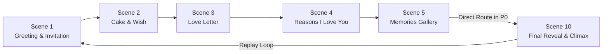

# Product Requirements Document (PRD)

**Project:** Girlfriend Birthday Website  
**Code Name:** Project Rose Arya  
**Target Recipient:** Girlfriend (Unconfirmed; candidate names "Rose" / "Arya" supported with publication-safe fallbacks)  
**Author / Sender:** Boyfriend (Bedant)  
**Hosting Destination:** GitHub Pages (`https://bedant1424.github.io/Love/`)  
**Target Delivery Window:** Under 24 hours (Birthday is tomorrow)  
**Phase:** Specification Baseline (Updated with P0 Flow & Accessibility Corrections)  

---

## 1. Product Vision & Goals

### 1.1 Vision Statement
To create an intimate, delightful, mobile-first birthday website that serves as a modern, interactive love letter and celebration. The website seamlessly blends playful romantic aesthetics (lavender, blush pink, warm cream surfaces, and midnight plum) with tactile, meaningful interactions (blowing out birthday candles, opening a 3D sealed envelope, browsing a Polaroid scrapbook, and discovering personalized surprises).

### 1.2 Core Product Goals
1. **Emotional Impact Over Generic Design:** Deliver a deeply personal experience that feels handmade, thoughtful, and unique, strictly avoiding generic SaaS cards or AI template tropes.
2. **Tactile & Interactive Engagement:** Every scene invites participation—tapping the candle flame to blow it out, clicking a wax seal to open the letter, flipping memory cards, and revealing surprises.
3. **Flawless Mobile Experience:** Over 90% of viewing time will occur on a mobile smartphone (iOS Safari / Android Chrome). The site must be fluid, finger-friendly, and responsive from 320px screen widths up to desktop viewports.
4. **Ruthless Prioritization for 24-Hour Delivery:** Prioritize a robust, bug-free, fully deployable P0 core experience for launch tonight, with clear P1 and P2 tiers that enhance the site if time permits without risking launch viability.
5. **Zero Maintenance Static Deployment:** Require no external database, user accounts, or backend servers. Host cleanly on GitHub Pages with instant load times and reliable asset caching.

---

## 2. Target Audience & User Persona

- **Primary User:** The girlfriend.
  - **Device Context:** iPhone / modern smartphone on mobile web (Safari, Chrome, or in-app browser from WhatsApp/iMessage).
  - **Emotional Context:** Viewing a heartfelt birthday surprise sent by her partner. She expects warmth, romance, playful inside jokes, genuine nostalgia, and clear readability.
  - **Technical Expectations:** Instant page load, zero confusing controls, smooth 60fps animations, pleasant music with easy mute controls, and zero broken links or unreadable text.
- **Secondary User / Author:** The boyfriend.
  - **Role:** Providing photos, personal memories, love letters, and quiz questions into a straightforward data schema (`content.ts`), then running a one-click deployment to GitHub Pages.

---

## 3. Scope & Prioritization Framework (P0 / P1 / P2)

### 3.1 The Exact P0 Working Story Flow
To guarantee zero dead ends and immediate completion under tomorrow's deadline, the working P0 flow is explicitly defined as:

```
P0 Story Flow (6 Active Chapters):
Scene 1 (Greeting) → Scene 2 (Cake) → Scene 3 (Letter) → Scene 4 (Reasons) → Scene 5 (Gallery) → Scene 10 (Finale)
```



- **Scene 5 to Scene 10 Direct Route:** In P0 launch mode, Scene 5 (Memories Gallery) features a prominent primary CTA button reading: `"See Your Birthday Finale ✨"`. Clicking this advances directly into Scene 10 without intermediate screens.
- **Chapter Progress Display:** In P0 mode, the bottom indicator displays `"Chapter X of 6"`. It has zero dead ends, broken next-buttons, or ghost references to missing Scenes 6–9.
- **Scene ID Preservation:** In codebase architecture and state routers, original Scene IDs are strictly preserved (`Scene1Greeting`, `Scene2Cake`, `Scene3Letter`, `Scene4Reasons`, `Scene5Gallery`, `Scene10Finale`) so that optional Scenes 6–9 can be cleanly slotted in without refactoring.

### 3.2 Feature Prioritization Tiers

| Priority Tier | Included Scenes / Features | Delivery Rationale |
| :--- | :--- | :--- |
| **P0: Launch-Critical** | **Scene 1 (Greeting)**<br/>**Scene 2 (Cake & Candle Wish)**<br/>**Scene 3 (Love Letter)**<br/>**Scene 4 (Reasons I Love You)**<br/>**Scene 5 (Memories Gallery)**<br/>**Scene 10 (Grand Finale & Replay)**<br/>Global Audio Controller, Chapter Progress, Deploy Pipeline | **Must have for tomorrow's launch.** Complete, emotionally fulfilling, and 100% bug-free. |
| **P1: High Emotional Value** | **Scene 6 (Relationship Timeline)**<br/>**Scene 8 (Surprise Gift Boxes)** | Built only if P0 is deployed and 2–3 hours remain before deadline. |
| **P2: Optional Enhancements** | **Scene 7 (Relationship Quiz)**<br/>**Scene 9 (Love Coupons & Playlist)**<br/>Microphone Candle Blow Detection<br/>LocalStorage State Persistence | Deferrable bonus features. Must not delay publishing. |

---

## 4. Scene-by-Scene Functional Requirements

### Scene 1: Opening Greeting & Invitation
- **Order:** 1 of 6 in P0 flow
- **Priority:** P0 (Launch-Critical)
- **Requirements:**
  - Display romantic headline with publication-safe fallback (`"Happy Birthday, Beautiful! 💕"`).
  - Ambient floating hearts and soft lavender/rose gradients.
  - Invitation card copy inviting her to step through her birthday surprise.
  - Primary button: `"Begin Our Story ✨"`.
  - On tap: Initializes audio playback (browser autoplay policy compliant) and transitions to Scene 2.

### Scene 2: Birthday Moment & The Candle Wish
- **Order:** 2 of 6 in P0 flow
- **Priority:** P0 (Launch-Critical)
- **Requirements:**
  - Ambient transition from soft cream/lavender into intimate **midnight plum** (`#160B1F`).
  - Conditional Countdown / Celebration Header:
    - If viewed prior to birthday: Live countdown hours/minutes/seconds.
    - If viewed on birthday: Celebratory banner: *"🎉 IT'S YOUR SPECIAL DAY! HAPPY BIRTHDAY! 🎉"*.
  - Illustrated cake (lavender frosting, blush pink tiers, golden sprinkles) with flickering golden candle flame.
  - Instruction: *"Close your eyes, make a wish, and tap the flame to blow it out! 🕯️"*.
  - Extinguish Action: Tapping flame extinguishes candle, spawns rising SVG smoke, triggers chime sound, unleashes `canvas-confetti` explosion, and unlocks primary CTA: `"Open Your Birthday Letter 💌"`.

### Scene 3: The Love Letter (3D Envelope Reveal)
- **Order:** 3 of 6 in P0 flow
- **Priority:** P0 (Launch-Critical)
- **Requirements:**
  - 3D physical envelope with golden wax seal button.
  - Tapping seal folds flap upward (`rotateX(180deg)`), slides letter upward, and expands into high-contrast parchment modal (`#FAF7F2`).
  - Dark plum typography (`#2D2635`, contrast 13.6:1) with comfortable line height (1.6) and smooth mobile scrolling.
  - Sign-off with romantic handwritten signature.
  - Action: `"Reasons Why I Love You 💖"` (advances to Scene 4).

### Scene 4: Reasons I Love You
- **Order:** 4 of 6 in P0 flow
- **Priority:** P0 (Launch-Critical)
- **Requirements:**
  - Interactive deck/grid of 6 heart-badged cards with cute icons and personal compliments.
  - Tap-to-reveal / 3D card flip interaction.
  - Progress tracker: *"3 of 6 reasons discovered"*.
  - Action: `"Look Back at Our Memories 📸"` (advances to Scene 5).

### Scene 5: Memories Gallery (Polaroid Scrapbook)
- **Order:** 5 of 6 in P0 flow
- **Priority:** P0 (Launch-Critical)
- **Requirements:**
  - Polaroid scrapbook frames with organic tilt angles (`-3deg` to `+3deg`), white borders, washi tape, and handwritten captions.
  - Tapping any photo opens an accessible, swipeable lightbox modal with close button, memory dates, and full caption.
  - **Local Fallback:** If personal photos are missing, renders charming illustrated SVG memory cards (never broken image icons or random stock photos).
  - **Direct P0 Route:** Primary button at bottom of gallery reads: `"See Your Birthday Finale ✨"`, which transitions directly to Scene 10.

### Scene 6: Relationship Timeline (P1 Enhancement)
- **Priority:** P1 (High Value)
- **Requirements:** Vertical milestone timeline with dates, mini photos, and story blurbs.

### Scene 7: Playful Relationship Quiz (P2 Enhancement)
- **Priority:** P2 (Optional)
- **Requirements:** 3 multiple-choice trivia questions with humorous feedback and 100% girlfriend award.

### Scene 8: Surprise Gifts (P1 Enhancement)
- **Priority:** P1 (High Value)
- **Requirements:** 3 clickable gift boxes with spring-animated lids revealing romantic vouchers and promises.

### Scene 9: Love Coupons & Playlist (P2 Enhancement)
- **Priority:** P2 (Optional)
- **Requirements:** Perforated love coupons with tap-to-stamp "Redeemed 💕" effect and Spotify playlist embed.

### Scene 10: Final Reveal & Grand Finale
- **Order:** 6 of 6 in P0 flow
- **Priority:** P0 (Launch-Critical)
- **Requirements:**
  - Intimate Midnight Plum and golden-star backdrop.
  - Hero photograph frame in glowing floral border (with SVG fallback).
  - Emotional climax message and heartfelt declaration.
  - Grand celebratory confetti shower.
  - Non-destructive `"Replay Our Story 🔄"` button smoothly navigating back to Scene 1.

---

## 5. Non-Functional Requirements (NFRs)

### 5.1 Accessibility (WCAG 2.1 AA Verified Standards)
- **Body & Headings:** Deep Plum text (`#2D2635`) on Cream parchment (`#FAF7F2`) achieves **13.64:1** contrast (WCAG AAA).
- **Primary Buttons:**
  - Deep Rose CTA (`#C2315D`) with White text achieves **5.40:1** contrast (WCAG AA Pass).
  - Deep Lavender CTA (`#7A4AC2`) with White text achieves **5.86:1** contrast (WCAG AA Pass).
  - Pastel buttons (`#E85D83`, `#9F7AEA`) must use Dark Plum text (`#241530`, **5.16:1+** contrast).
- **Reduced Motion:** When `prefers-reduced-motion` is active, disable all 3D rotations, continuous particle loops, and translation slides; replace with gentle 150ms opacity fades.
- **Touch Target Floor:** All interactive controls maintain minimum 44×44px hit areas with ≥8px spacing.

### 5.2 Performance & Responsiveness
- **Bundle Size:** Initial JS + CSS < 250KB gzipped.
- **Viewport Ergonomics:** Use `min-h-[100dvh]` to eliminate iOS Safari browser bar jumps.
- **Loading:** Images loaded with `loading="lazy"` except hero image (`fetchpriority="high"`).

### 5.3 Audio Policy
- Strict no-autoplay on initial page load. Audio initializes only upon user tap of the Scene 1 CTA. Persistent floating mute toggle (`top-4 right-4 z-50`).

---

## 6. Acceptance Criteria

| ID | Feature | Acceptance Criteria | Priority |
| :--- | :--- | :--- | :--- |
| **AC-01** | **P0 Flow** | User navigates smoothly: Scene 1 → 2 → 3 → 4 → 5 → 10 without dead ends. | P0 |
| **AC-02** | **Scene 5 Exit** | Scene 5 CTA reads "See Your Birthday Finale ✨" and opens Scene 10 directly. | P0 |
| **AC-03** | **Chapter Counter** | Bottom indicator displays "Chapter X of 6" in P0 mode without ghost references. | P0 |
| **AC-04** | **Candle Wish** | Tapping candle flame extinguishes it, releases smoke, fires confetti, and unlocks next button. | P0 |
| **AC-05** | **Love Letter** | Wax seal tap unfolds 3D envelope and displays readable high-contrast parchment letter. | P0 |
| **AC-06** | **Fallbacks** | Missing photos render SVG memory art; missing audio defaults to gentle silence. Zero raw bracket strings visible. | P0 |
| **AC-07** | **Contrast** | All buttons and text pass WCAG AA (≥4.5:1). | P0 |
| **AC-08** | **Deploy Pipeline**| Build succeeds with React 18.3.1, Tailwind 3.4.1, Vite 5.4.2; `predeploy` builds before `gh-pages` publish. | P0 |
